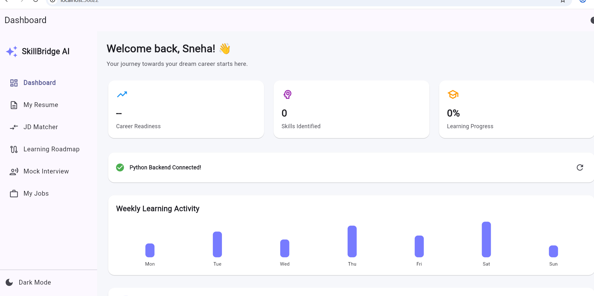
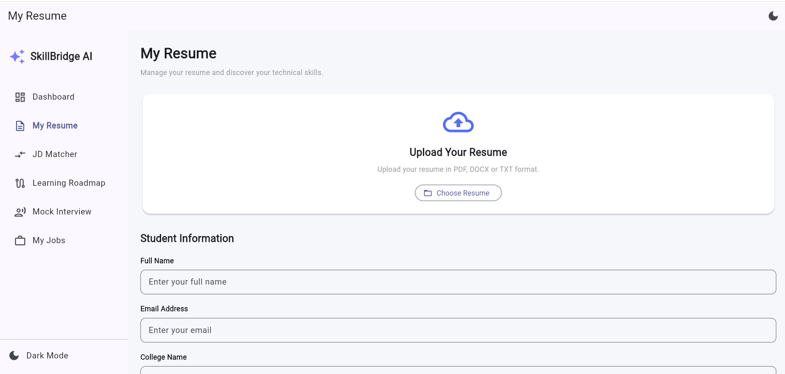
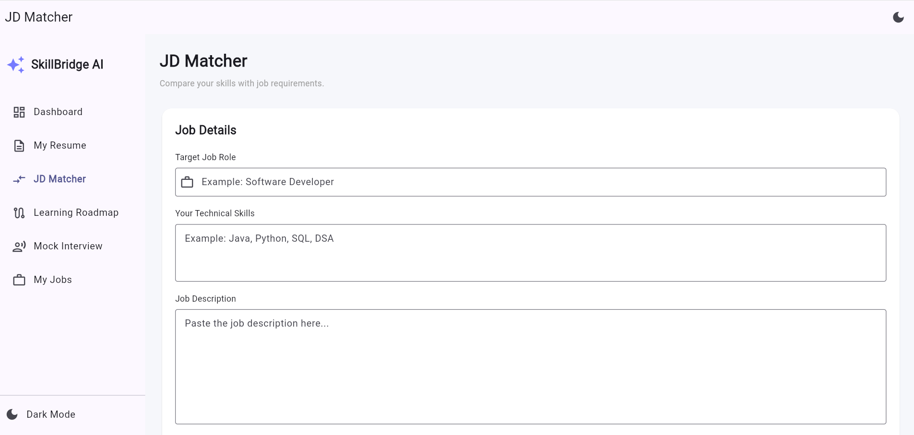
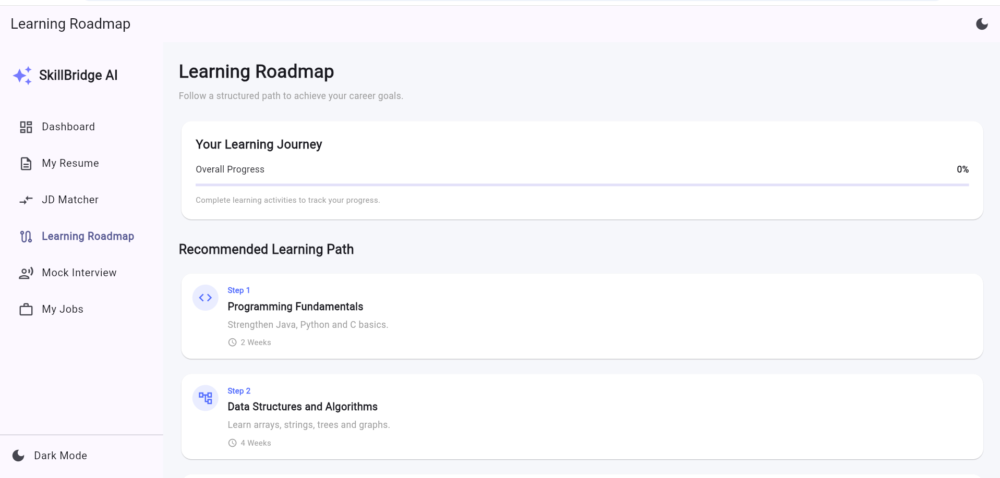
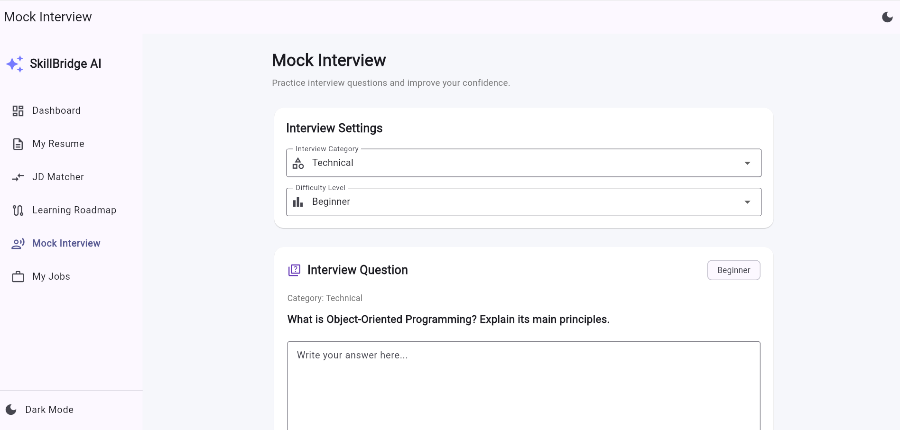
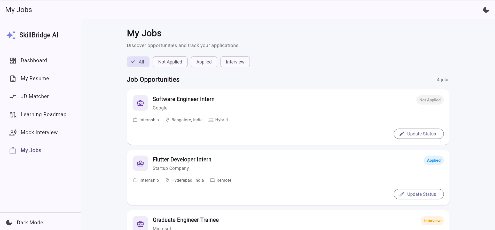

# SkillBridge AI

**SkillBridge AI** is a career-preparation platform designed to help students understand their skills, compare them with target job roles, follow a structured learning path, and practise interview questions.

The project combines a Flutter frontend with a Python FastAPI backend.

## Application Screenshots

### 1. Dashboard
The dashboard provides an overview of career readiness, identified skills, learning progress, backend connection status, and weekly learning activity.



### 2. Resume Analyzer
Upload a resume in PDF, DOCX, or TXT format and review the technical skills identified by the backend. The screen also includes student profile fields.



### 3. Job Description (JD) Matcher
Enter a target job role and your current technical skills to compare them with the skills expected for that role.



### 4. Learning Roadmap
Follow a structured learning path covering programming fundamentals, data structures and algorithms, and other career-preparation topics. Track completed activities and overall progress.



### 5. Mock Interview
Practise questions across interview categories and difficulty levels, write answers, and review feedback from the current practice flow.



### 6. My Jobs
View sample job opportunities and organise application statuses such as Not Applied, Applied, and Interview.



## Features

- Responsive Flutter web interface with dashboard navigation
- Resume upload for PDF, DOCX, and TXT files
- Resume text extraction and keyword-based skill identification
- Role-based skill gap analysis
- Learning roadmap with topic completion tracking
- Mock interview practice with category and difficulty selection
- Sample job opportunity list and application-status tracking
- Light and dark mode
- FastAPI backend with health-check endpoint

## Technology Stack

| Area | Technologies |
|---|---|
| Frontend | Flutter, Dart |
| Backend | Python, FastAPI |
| API communication | HTTP, REST |
| Resume processing | pypdf, python-docx |
| File upload | file_picker |
| Development tools | VS Code, Git, GitHub |

## Project Structure

```text
skillbridge-ai/
├── backend/
│   ├── main.py
│   └── ...
├── lib/
│   ├── main.dart
│   ├── screens/
│   │   ├── resume_screen.dart
│   │   ├── jd_matcher_screen.dart
│   │   ├── roadmap_screen.dart
│   │   ├── mock_interview_screen.dart
│   │   └── jobs_screen.dart
│   ├── services/
│   │   └── api_service.dart
│   └── widgets/
├── screenshots/
│   ├── dashboard.png
│   ├── resume-analyzer.png
│   ├── jd-matcher.png
│   ├── learning-roadmap.png
│   ├── mock-interview.png
│   └── my-jobs.png
└── README.md
```

## Getting Started

### Prerequisites

- Flutter SDK
- Dart SDK (included with Flutter)
- Python 3
- Git

### 1. Clone the repository

```bash
git clone https://github.com/sneha-mankala/skillbridge-ai.git
cd skillbridge-ai
```

### 2. Install Flutter dependencies

```bash
flutter pub get
```

### 3. Set up the Python backend

Open a terminal in the backend directory:

```bash
cd backend
python -m venv venv
```

Activate the virtual environment.

**Windows PowerShell:**

```powershell
.\venv\Scripts\Activate.ps1
```

Install the backend dependencies:

```bash
python -m pip install fastapi uvicorn python-dotenv python-multipart pypdf python-docx
```

Start the backend:

```bash
python -m uvicorn main:app --reload --host 127.0.0.1 --port 8000
```

The API will be available at:

- API root: `http://127.0.0.1:8000/`
- Interactive API documentation: `http://127.0.0.1:8000/docs`

Keep this terminal running while using features that call the backend.

### 4. Run the Flutter application

Open a second terminal in the project root (`skillbridge-ai`) and run:

```bash
flutter run -d chrome
```

## Current Implementation Notes

- Resume skill extraction and role matching currently use keyword/rule-based logic. They should not be described as a trained AI model.
- Mock interview feedback is based on the current application's evaluation logic; it is not a human assessment or a guaranteed AI evaluation.
- The jobs page currently displays sample opportunities. It is not connected to a live job-listing service.
- Learning progress is currently maintained by the application's screen state; persistent account-based tracking is not yet described as implemented.
- Scanned/image-only PDF files may require OCR before their text can be extracted.

## Future Enhancements

- Integrate an LLM for contextual resume and interview feedback
- Connect to live job and internship APIs
- Add user authentication and cloud-based progress storage
- Generate personalised roadmaps from resume and job-description analysis
- Add exportable skill-gap and career-readiness reports

## Author

**Sneha Mankala**

- GitHub: [sneha-mankala](https://github.com/sneha-mankala)

---

*Built as a student project to support career preparation and skill development.*
